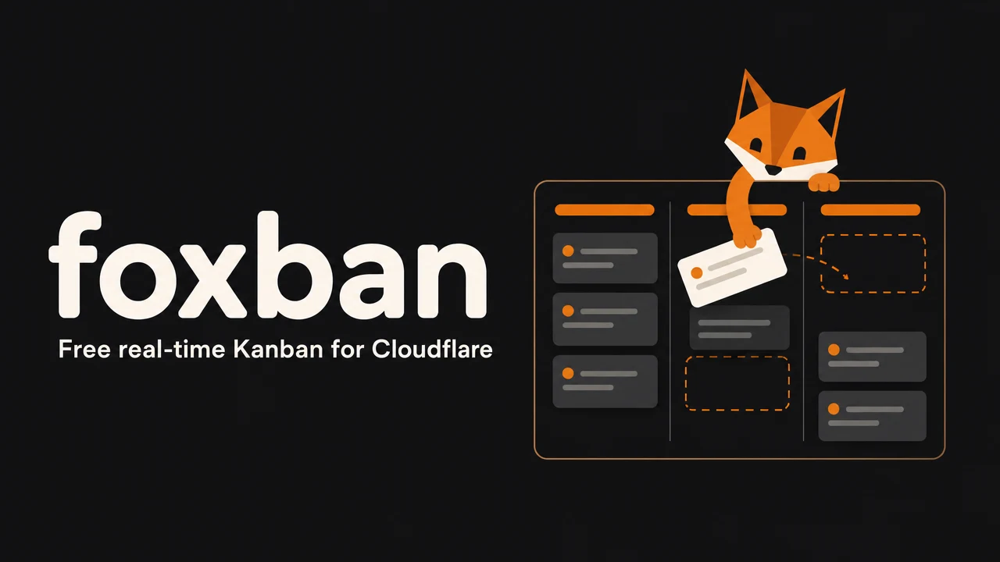
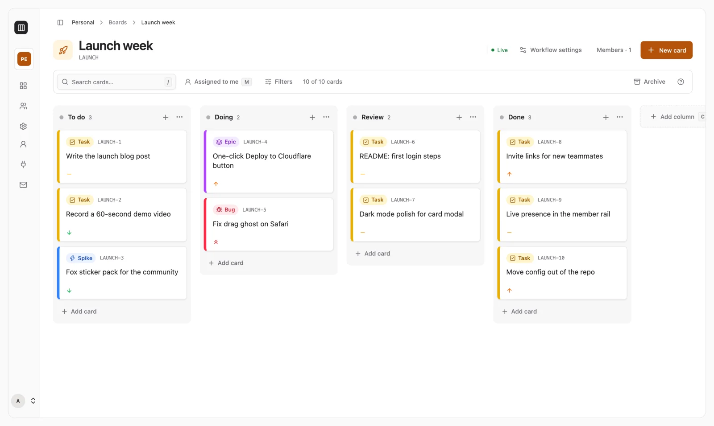

<p align="center">
  
</p>

# foxban

Free, real-time Kanban for Cloudflare.

[](LICENSE)
[](#1-the-deploy-button)

[Deploy](#pick-how-to-deploy) · [First login](#your-first-login) · [Settings](#settings) · [GitHub](#advanced-github) · [Updating](#updating) · [Help build it](#for-people-who-want-to-help)

foxban is a Kanban board that you run on your own Cloudflare account. When a teammate moves a card, you see it move right away. The free Cloudflare plan is enough for a small team.



## What you get

- Boards with columns and cards. You drag cards to move them.
- Changes show up live for everyone on the board.
- Cards can have notes, pictures, checklists, due dates and comments.
- People join by invite only.
- If you want, cards show their GitHub branches and pull requests, and can make them.
- Coding agents can read and change boards through an [MCP endpoint](docs/mcp.md).

## What you need

- A Cloudflare account. The free plan works.
- R2 turned on in that account. R2 is free for small use, but Cloudflare asks you to add a payment method and start a $0 R2 plan first.
- To deploy from your own computer, you also need [Node.js](https://nodejs.org) 22 or newer and [pnpm](https://pnpm.io).

## Pick how to deploy

There are two ways to deploy. Pick one.

| Way | Good for |
|---|---|
| [1. The Deploy button](#1-the-deploy-button) | The fastest start. You click, link GitHub or GitLab, and type your email. |
| [2. From your computer](#2-from-your-computer) | You want to run one command when you want to update. |

### 1. The Deploy button

<a href="https://deploy.workers.cloudflare.com/?url=https://github.com/kitsupanic/foxban" target="_blank" rel="noopener"></a>

Before you start:

- Have a Cloudflare account. If you do not have one, the button asks you to make one.
- Turn on R2 in your Cloudflare account. Go to **R2 Object Storage** in the dashboard and start the $0 plan. Cloudflare asks for a payment method for this, but small use is free. If you skip this, the deploy fails when it makes the file storage.

Then:

1. Click the button. It opens in a new tab.
2. Sign in to Cloudflare. Link your GitHub or GitLab account to Cloudflare when it asks. Cloudflare makes a copy of foxban in that account.
3. When it asks for `ADMIN_EMAILS`, type your email.
4. Click **Deploy**. Wait for it to finish.
5. Open the link that it shows you. Then go to [Your first login](#your-first-login).

The button sets up everything that foxban needs. This includes the database (D1) and the file storage for pictures (R2).

### 2. From your computer

Get the code and install it:

```bash
git clone https://github.com/kitsupanic/foxban.git
```

```bash
cd foxban && pnpm install
```

Sign in to Cloudflare:

```bash
pnpm exec wrangler login
```

Make your settings file. Copy the example file:

```bash
cp .env.deploy.example .env.deploy
```

Open `.env.deploy` and set `ADMIN_EMAILS` to your email. You can leave the rest as it is.

Deploy:

```bash
pnpm run deploy
```

The first time, this makes the database and the file storage for you. At the end, it shows the link to your foxban. Then go to [Your first login](#your-first-login).

Your `.env.deploy` file stays on your computer. Git does not send it anywhere.

## Your first login

1. Open your foxban.
2. Click **Sign up**. Use the email that you put in `ADMIN_EMAILS`.
3. Pick a password.

> [!WARNING]
> Sign up right after you deploy. foxban does not check that an email is really yours. Until you sign up, whoever types an address from `ADMIN_EMAILS` on the sign-up page gets that admin account.

You are now an admin. An admin can make invite links. Send an invite link to each person who should join. Nobody can sign up without one, except admins. A link works once, and stops working 7 days after you make it.

### More than one admin

`ADMIN_EMAILS` can hold more than one email. Put commas between them. Write each full address, like `you@example.com,boss@example.com`. A pattern such as `*@example.com` does nothing: foxban skips it. Each admin should sign up soon after the deploy, for the reason in the warning above.

### "No admin yet"

Does foxban say that it has no admin yet? Then `ADMIN_EMAILS` is not set. Set it in Cloudflare (**Workers → foxban → Settings → Variables and Secrets**), and then sign up again.

> [!IMPORTANT]
> Pick the type **Secret**. If you pick **Text**, the next deploy wipes it out.

## Settings

You set these in `.env.deploy`. Only `ADMIN_EMAILS` is needed.

| Name | What it does | If you leave it out |
|---|---|---|
| `ADMIN_EMAILS` | Full emails of the people who are admins, with commas between them. No `*@` patterns. | You must set this one. Deploy stops without it. |
| `WORKER_NAME` | The name of your foxban in Cloudflare. | `foxban` |
| `D1_DATABASE_NAME` | The name of the database. | The same as `WORKER_NAME` |
| `R2_BUCKET_NAME` | The name of the file storage for pictures. | `WORKER_NAME` and then `-attachments` |
| `CUSTOM_DOMAIN` | Your own web address, like `board.example.com`. The domain must be on your Cloudflare account. | You get a `workers.dev` address. |
| `RATE_LIMIT_NAMESPACE_ID` | A number that must be different for each foxban on one Cloudflare account. | `1001` |

`.env.deploy.example` has the full list, with notes.

> [!CAUTION]
> Be careful when you change a name later. A new name makes a new, empty foxban. Your old boards stay under the old name.

## Advanced: GitHub

You do not need this. foxban works without GitHub.

### What it does

- **See GitHub work on cards.** A branch or pull request that has the card's key in its name, title or text shows on that card. The key looks like `KR-42`. It updates in seconds, with no reload.
- **Work from a card.** Make a branch or a pull request from a card. Link a pull request by hand when it has no key.
- **Sign in with GitHub.** Link your GitHub account in **Profile**. Then your GitHub picture shows up as your picture, and you can use **Log in with GitHub**. Your email and password keep working.

With an invite link, a new person can also sign up with GitHub. An account made that way has no password. Set one in **Profile**. Then you can also disconnect GitHub or change your email.

### Set it up

An admin does this once:

1. Open **GitHub** in the account menu.
2. Press **Create GitHub App**. GitHub asks you to confirm, and then sends you back to foxban.
3. Press **Install on repos** and pick the repos.

Those repos are now connected for everyone, on all boards. You do not need to set anything in your environment or in GitHub. foxban keeps the App's secrets for you.

> [!IMPORTANT]
> The first deploy makes a key to protect the App's secrets. Do not change that key. If you do, the App stops working, and you must make it again.

> [!NOTE]
> Did you use the old way, with settings like `GITHUB_APP_ID`? You can delete those settings. foxban does not read them any more, and boards no longer have their own repo. Press **Create GitHub App** once, and link your GitHub account again in **Profile**.

## Updating

Each update can change the database. You do not need to do anything for that. Every deploy updates the database for you before the new code goes live.

- **Deploy button:** your copy of foxban is a repo in your GitHub or GitLab account. It is a copy, not a fork, so there is no sync button for it. Pull the new code from this repo into your copy, and push it. Cloudflare deploys each push on its own:

  ```bash
  git pull https://github.com/kitsupanic/foxban.git main && git push
  ```
- **From your computer:** run `git pull && pnpm install && pnpm run deploy`.

## How it is built

- **API:** [Hono](https://hono.dev) on Cloudflare Workers. Each board is one Durable Object with its own SQLite, and it talks to browsers over hibernating WebSockets.
- **Web:** a React single-page app built with Vite.
- **Storage:** D1 for users, sessions and board metadata, R2 for attachments. Card data lives only in the board's Durable Object.
- **Agents:** an [MCP endpoint](docs/mcp.md) lets coding agents read and change boards.

## For people who want to help

- Read [CONTRIBUTING.md](CONTRIBUTING.md).
- Run it on your computer with `pnpm dev:api` and `pnpm dev:web`.
- Check your work with `pnpm typecheck` and `pnpm test`.
- [docs/architecture.md](docs/architecture.md) shows how foxban works.
- [docs/decisions/](docs/decisions/) says why it works that way.
- [AGENTS.md](AGENTS.md) has the rules for coding agents, and they help people too.
- Found a security bug? Read [SECURITY.md](SECURITY.md).

## License

MIT. See [LICENSE](LICENSE).

foxban is not made by Cloudflare, and Cloudflare does not support it.
